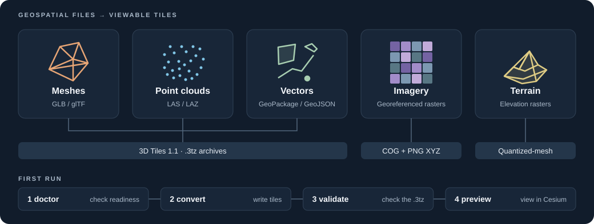

# rusty-tiles

**Turn meshes, point clouds and vector data into 3D Tiles you can view, share and update.**

rusty-tiles converts textured GLB/glTF meshes, LAS/LAZ point clouds and GeoJSON/GeoPackage vectors into 3D Tiles 1.1 archives (`.3tz`). It runs offline and needs no GDAL, PROJ or GEOS installation. It ships as a command-line tool, a Python wheel (for scripts and Blender add-ons) and a Rust library, and the CLI includes archive validation and a local Cesium preview.

> **Status:** rusty-tiles is pre-1.0 and under active development. Command-line options, the Python and Rust APIs, report and `conversion.json` fields, error types and archive bytes can change in any release, including patch releases. Each such change is listed under "Breaking changes" in the [release notes](CHANGELOG.md). Pin a version for anything you depend on (`pip install rusty-tiles==0.4.1`, `install.sh --version 0.4.1`). Output archives are standard 3D Tiles 1.1, so viewers such as CesiumJS are not affected.



[Release notes](CHANGELOG.md) · [Documentation](#documentation) · [Report an issue](https://github.com/BenDyson-Arch/rusty-tiles/issues) · Licence `MIT AND Apache-2.0 AND BSD-3-Clause` ([details](#licence))

## Install

**macOS / Linux** (Apple Silicon Macs with macOS 15+; Linux on x86_64 or ARM64 with glibc 2.35+; Intel Macs: see [INSTALL](docs/INSTALL.md#intel-macs)):

```sh
curl -fsSL https://raw.githubusercontent.com/BenDyson-Arch/rusty-tiles/main/scripts/install.sh | sh
export PATH="$HOME/.local/bin:$PATH"
rusty-tiles --version
```

The installer puts the latest release in `~/.local/bin` after checking its checksum. Add the `export PATH` line to your shell's startup file.

**Windows (x64):** download `rusty-tiles-VERSION-x86_64-pc-windows-msvc.zip` from the [latest release](https://github.com/BenDyson-Arch/rusty-tiles/releases/latest), extract it and run `.\rusty-tiles.exe --version`.

**Python** (CPython 3.10+):

```sh
python -m pip install rusty-tiles
```

**From source** (stable Rust and a C++ compiler):

```sh
cargo install --git https://github.com/BenDyson-Arch/rusty-tiles --tag v0.4.0 --locked
```

The [installation guide](docs/INSTALL.md) covers every option, including the native-geospatial build below.

## Quick start

Convert a small example mesh, place it near Brisbane and check it:

```sh
curl -fsSLo example.glb https://raw.githubusercontent.com/BenDyson-Arch/rusty-tiles/main/tests/fixtures/example.glb
rusty-tiles mesh -i example.glb -o example.3tz --anchor 153.02 -27.47 0
rusty-tiles validate example.3tz
```

To view it, install the Cesium runtime once (needs Node.js and npm), extract the archive and serve it:

```sh
npm install --prefix preview-runtime --no-save --package-lock=false cesium@1.146.0
unzip example.3tz -d example
rusty-tiles preview --cesium preview-runtime/node_modules/cesium/Build/Cesium --mesh example
```

Open <http://127.0.0.1:9227/> and use **3D mesh extent** to frame the model. The viewer works offline and needs no Cesium ion token. Press Ctrl+C to stop it.

## Commands

| Your data | Command | Output |
| --- | --- | --- |
| Textured GLB or glTF meshes | `mesh` | Streamed 3D Tiles with exact leaves and simplified, textured coarse levels |
| LAS or LAZ point clouds | `point-cloud` | 3D Tiles with sampled parents and full-detail leaves |
| GeoJSON or GeoPackage layers | `vector` | glTF vector tiles (experimental) |
| An existing model or tileset | `glb-to-3tz`, `createTilesetJson`, `convert` | `.3tz` or `tileset.json`, without new levels of detail |
| Any `.3tz` | `validate` | A report of what was checked and what was not |
| Converted output | `preview` | A local Cesium viewer |

Every converter takes `-i` and `-o`, never overwrites an existing output unless you add `--force`, and publishes nothing if it fails. Run `validate` on an archive before you publish it. To update a vector archive after editing its source, pass the earlier archive with `--reuse-tileset`; unchanged tiles are reused byte for byte.

```sh
rusty-tiles mesh -i model.glb -o model.3tz --source-crs EPSG:32756 --source-offset 502000 6961000 0 --height-offset 0
rusty-tiles point-cloud -i cloud.laz -o cloud.3tz --source-crs header --height-offset 0
rusty-tiles vector -i mapping.gpkg -o mapping.3tz --layer roads
```

The [command reference](docs/CLI.md) lists every option, exit code and JSON output.

## Coordinates and height

rusty-tiles never guesses a vertical datum. A mesh is either local metres (optionally placed with `--anchor lon lat height`) or declared with `--source-crs`. Point clouds and 3D vectors in a horizontal CRS need `--height-offset`; `0` is right only when heights are already ellipsoidal metres. Of EPSG codes, the standard build transforms WGS84 geographic, WGS84 UTM and Web Mercator and about 3,100 codes from a [GDAL-verified allow-list](docs/FORMATS.md#gdal-verified-epsg-allow-list), such as GDA2020/GDA94 MGA, NZTM2000 and ETRS89 UTM (plus WKT/PROJ projections with explicit datum shifts); other CRSs need the native-geospatial build, and an operation that needs missing datum grids is refused, never approximated. Each guide gives the rules for its input: [mesh](docs/MESH.md), [point clouds](docs/FORMATS.md), [vectors](docs/VECTOR.md).

## Python and Rust

```python
import rusty_tiles

result = rusty_tiles.mesh_to_tileset("example.glb", "example.3tz", anchor=(153.02, -27.47, 0.0))
assert rusty_tiles.validate(result.output)["ok"]
```

The wheel contains the same converters as the standard CLI (`mesh_to_tileset`, `point_cloud_to_3tz`, `vector_to_3tz`, `glb_to_3tz`, `convert_to_3tz` and `validate`) with no GDAL or other Python packages. See the [Python guide](bindings/python/README.md).

In Rust, each converter takes a request, a `RunControl` for progress and cancellation, and returns a typed result:

```rust
use rusty_tiles::{mesh_to_tileset, RunControl, TilerRequest};

let result = mesh_to_tileset(TilerRequest::new("model.glb", "model.3tz"), &RunControl::new(None))?;
```

## Native-geospatial build

A separate build adds what needs GDAL, PROJ and GEOS: imagery (`raster`, to COG and XYZ tiles), elevation (`terrain`), Shapefile and other OGR vector formats, and CRSs beyond WGS84 geographic, UTM and Web Mercator. Most users do not need it. It is published as a Linux amd64 container:

```sh
docker run --rm --platform linux/amd64 --network none \
  -v "$PWD:/data" -w /data ghcr.io/bendyson-arch/rusty-tiles:v0.4.0 \
  raster -i orthophoto.tif -o imagery --max-zoom 14
```

It can also be built with Cargo against system libraries; see [native-geospatial setup](docs/INSTALL.md#native-geospatial-cli). The Python wheel has no native variant.

## Documentation

- [Installation](docs/INSTALL.md): downloads, wheels, the container and source builds.
- [Choosing a converter](docs/CONVERTERS.md): inputs, builds and placement.
- [Mesh guide](docs/MESH.md): sources, placement, profiles, resources and migration from 0.3.
- [Point clouds and imagery](docs/FORMATS.md) · [Vectors](docs/VECTOR.md) · [Terrain](docs/TERRAIN.md)
- [Validation](docs/VALIDATION.md): what `validate` checks.
- [Command reference](docs/CLI.md): every option, exit code and progress event.
- [Contributing](CONTRIBUTING.md): building, testing and releasing.

## Licence

rusty-tiles is [MIT](LICENSE). The vendored [Basis Universal](vendor/README.md) texture encoder is Apache-2.0 and the Zstandard code it bundles is BSD-3-Clause, hence the licence expression `MIT AND Apache-2.0 AND BSD-3-Clause`. Licences of the Rust crates it uses (all permissive) are generated into [`licenses/`](licenses/) and shipped with every download, wheel and image; the container image also lists its GDAL, PROJ, GEOS, SQLite and libtiff libraries (GEOS is LGPL-2.1-or-later, dynamically linked).
